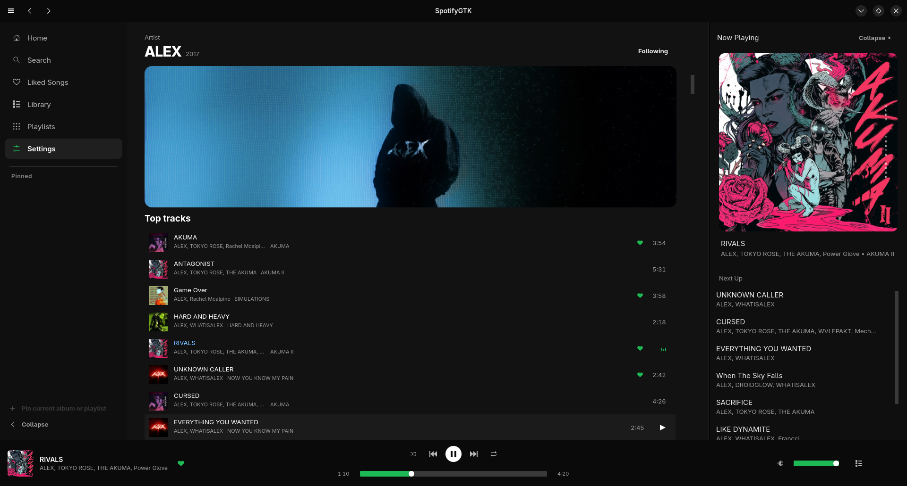
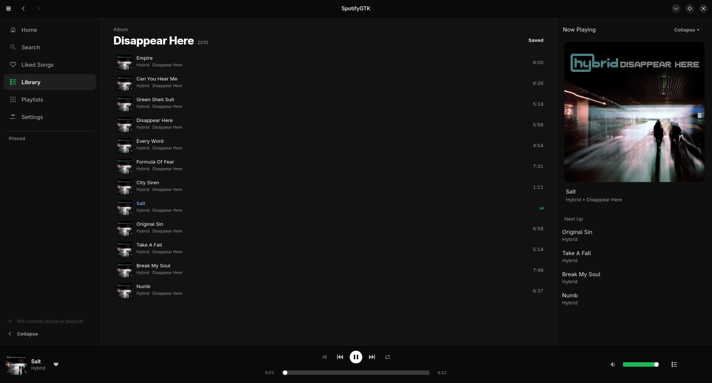
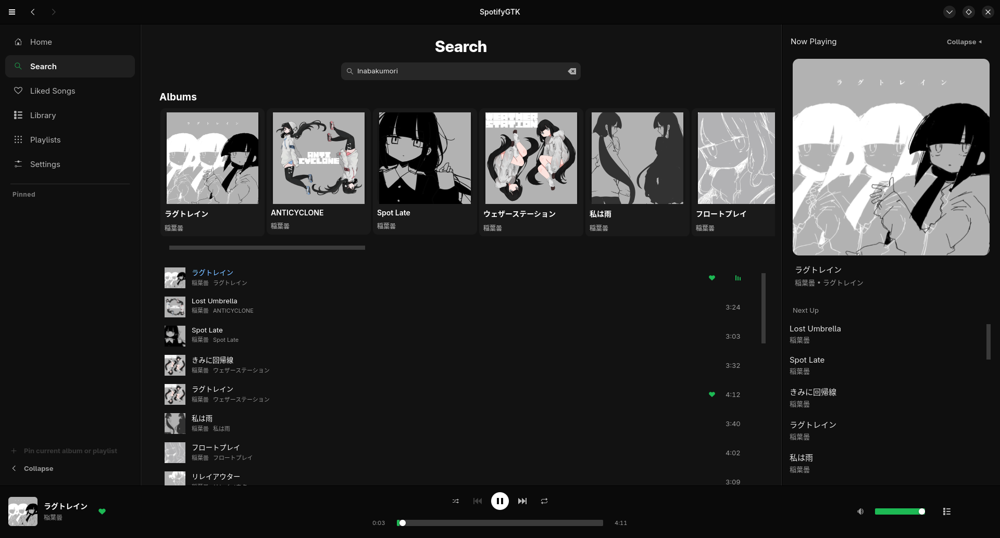
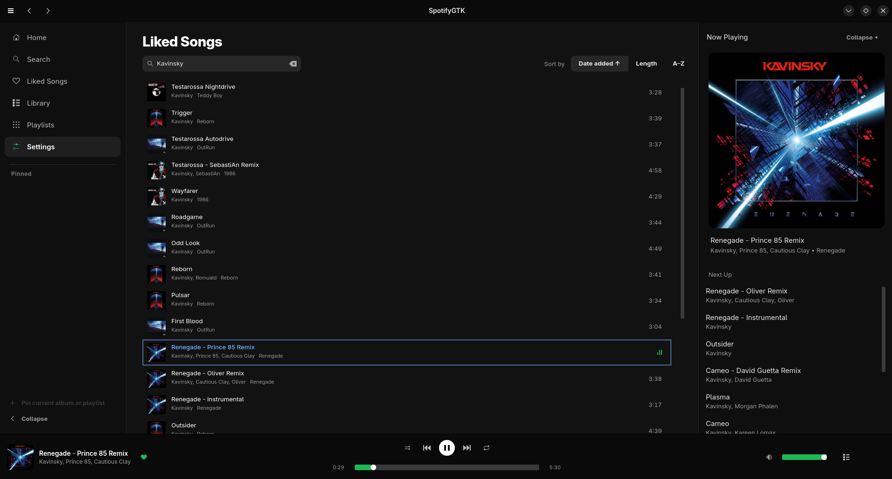
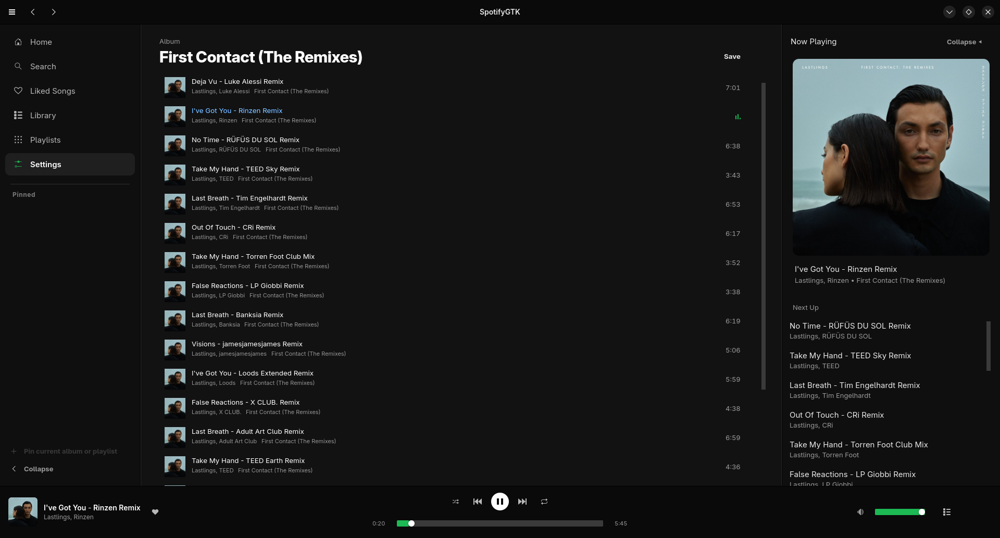
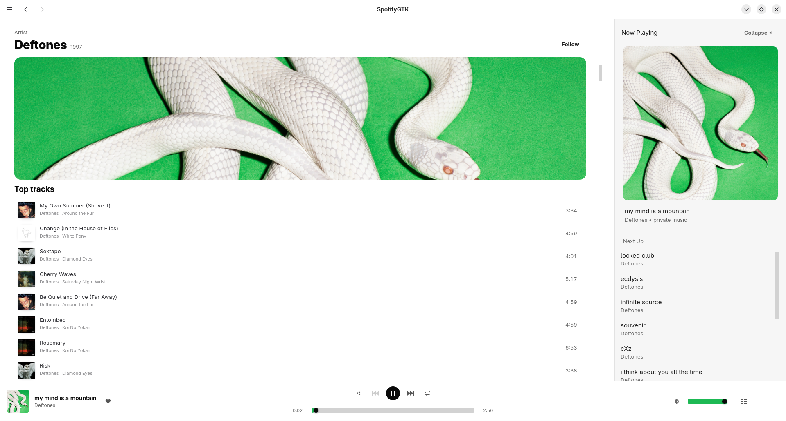

# SpotifyGTK

A native Spotify player for **Linux and Windows**, written in C with GTK4 and
libadwaita. It signs in to Spotify, browses your music and plays streams
directly—without running Spotify's desktop app.


[](https://github.com/martiancomputer/SpotifyGTK/releases/latest)

**Latest release: [1.1.2](https://github.com/martiancomputer/SpotifyGTK/releases/tag/v1.1.2).**
Linux packages and a signed Windows MSIX are available.

> Spotify streaming requires a **Premium account**. The client does not bypass
> Spotify's account or service checks. Unofficial clients may not comply with
> Spotify's terms; use at your own risk. SpotifyGTK is independent and is not
> affiliated with or endorsed by Spotify AB. See [the legal notes](research/legal.md).

## What works today

| Area | Available features |
|---|---|
| **Play music** | Stream tracks from search, playlists, albums and artist radio; gapless playback, seeking, shuffle, Smart Shuffle recommendations, repeat, lyrics and a 15-band equalizer. |
| **Browse** | Personalized Home, Search, Library, Liked Songs, album and artist pages, queue and Now Playing panel. |
| **Manage your music** | Like tracks, save albums, follow artists, filter your library and create playlists. Official Spotify clients can transfer playback to SpotifyGTK and control it remotely via Spotify Connect. |
| **Play local files** | Optional FFmpeg support for FLAC, Opus, WAV, M4A and AAC. Add folders in Settings; tags and embedded artwork are read by the background scanner. |
| **Personalize** | Four themes, 25–300% interface scaling, configurable shortcuts, saved volume, audio output settings, renderer selection and artwork caching. |

Local favorites and device-only playlists are stored separately from Spotify.
Local tracks are not uploaded as Spotify tracks. Artwork and metadata caching is
bounded; downloaded artwork is available offline.

### Experimental

- **High-refresh rendering:** frame-rate limits are available with the optional
  GTK4-Enhanced runtime: Default, 30, 60, 90, 120, 144, 240 and 360 FPS. The
  display, compositor and renderer can limit the actual presented rate.
### Not implemented or unsupported

- **Home customization:** a Settings entry is reserved for it; controls are not
  implemented yet.
- **Podcasts, video and promotional feed sections:** not displayed.
- **Free-account streaming:** Spotify's service requires Premium for playback.

## Screenshots

| | |
|:---:|:---:|
|  |  |
| **Artist** — top tracks, follow and discography | **Album** — artwork, track list and save controls |
|  |  |
| **Search** — tracks and albums together | **Liked Songs** — filter and sort your tracks |
|  |  |
| **Now Playing** — artwork, queue and lyrics | **Light theme** — artist page |

## Download

Get the `.deb`, `.appimage`, Windows `.msix` and public signing certificate
from the [1.1.2 release page](https://github.com/martiancomputer/SpotifyGTK/releases/tag/v1.1.2).
For Windows, install the included `.cer` into **Trusted People** before the
MSIX; follow the [Windows installation guide](apps/spotify-native-windows/INSTALL-MSIX.md).

On first launch, sign in through the browser. The login credential is stored
locally and reused on later starts.

## Build from source

Source builds target GTK 4.22.4 and libadwaita 1.9.0 or newer. Ubuntu 24.04's
defaults are older; older libraries can be allowed with `-Dallow_old_gtk=true`
and `-Dallow_old_libadwaita=true`, but the layout may differ. Release packages
include the pinned GTK runtime.

Building from source also needs GLib, libsoup, JSON-GLib, Ogg/Vorbis, OpenSSL
and an audio output development package. FFmpeg development libraries enable
local-file playback. This package list is for Ubuntu 26.04 or newer:

```sh
sudo apt install build-essential meson ninja-build pkg-config \
  libglib2.0-dev libsoup-3.0-dev libjson-glib-dev libgtk-4-dev \
  libadwaita-1-dev libogg-dev libvorbis-dev libssl-dev \
  libpulse-dev libasound2-dev libavformat-dev libavcodec-dev \
  libavutil-dev libswresample-dev
```

Then, from the repository root:

```sh
meson setup apps/spotify-native/build apps/spotify-native \
  --native-file apps/spotify-native/build-profiles/stable.ini
meson compile -C apps/spotify-native/build
meson test -C apps/spotify-native/build --print-errorlogs
apps/spotify-native/build/src/spotify-native
```

`-Dlocal_playback=enabled` requires FFmpeg; `-Dlocal_playback=disabled` omits
local decoding. Release builds require FFmpeg so local playback is not silently
left out. For PipeWire, use `build-profiles/nightly.ini`. Interface shortcuts
include Ctrl++/Ctrl+- for scaling and Space for play/pause (Space is ignored
while typing in a text field).

For the optional Linux frame-rate experiment, see
[`packaging/build-enhanced-gtk.sh`](packaging/build-enhanced-gtk.sh) and the
[performance notes](research/internals.md).

Windows uses the same native source with its own toolchain and packaging steps;
see the [Windows build guide](apps/spotify-native-windows/README.md). The Linux
release packages and Windows MSIX include the pinned GTK4-Enhanced runtime.

## Project details

SpotifyGTK is licensed under [GPL-3.0](LICENSE), with an attribution requirement
described in the license. See [third-party notices](THIRD_PARTY_LICENSES) for
upstream code and protocol references. Architecture and protocol research are
in [project internals](research/internals.md).

Found a bug? [Open an issue](https://github.com/martiancomputer/SpotifyGTK/issues)
with reproduction steps, your operating system and build type. Check logs for
account information before sharing them.
